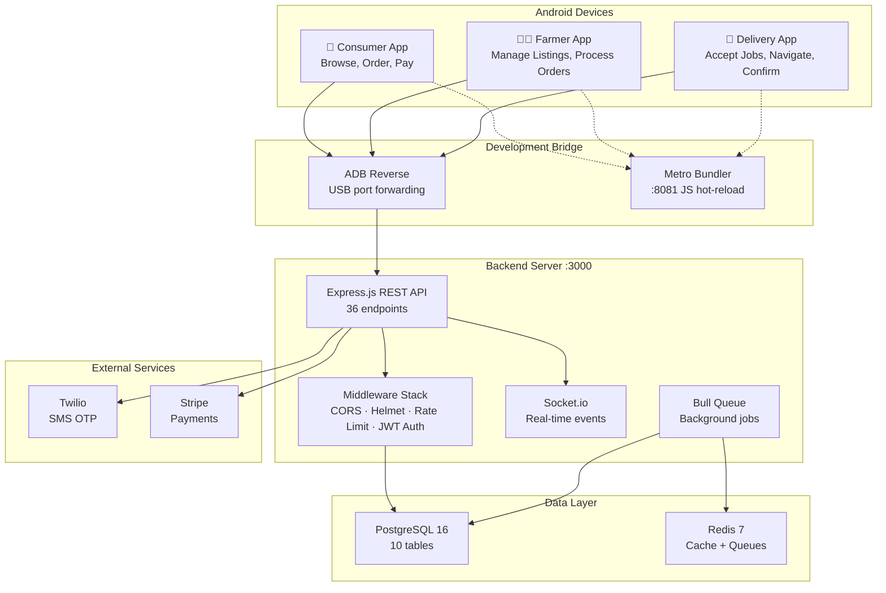
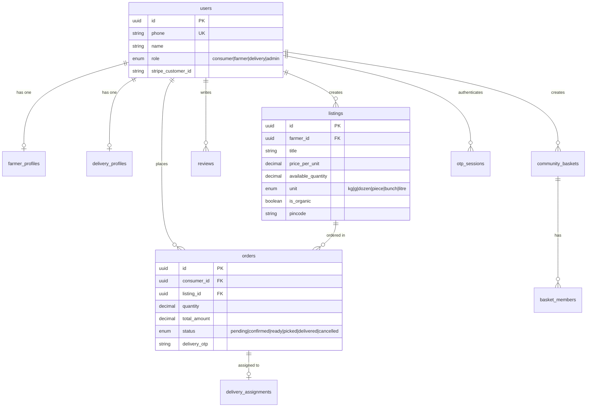
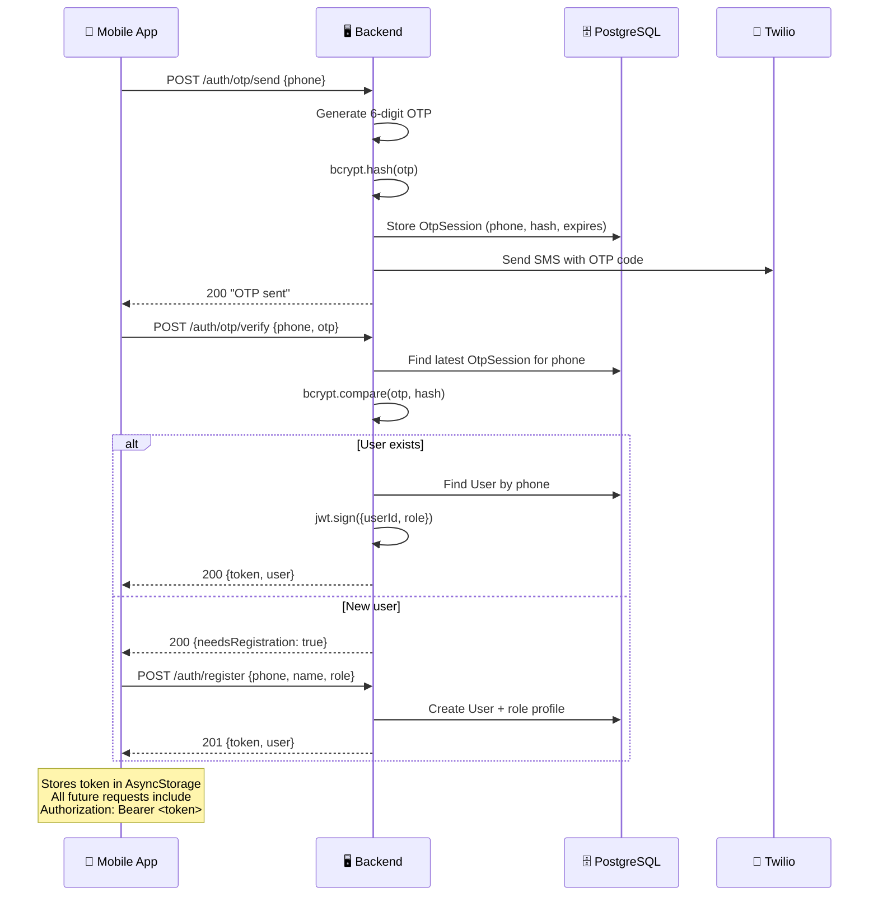
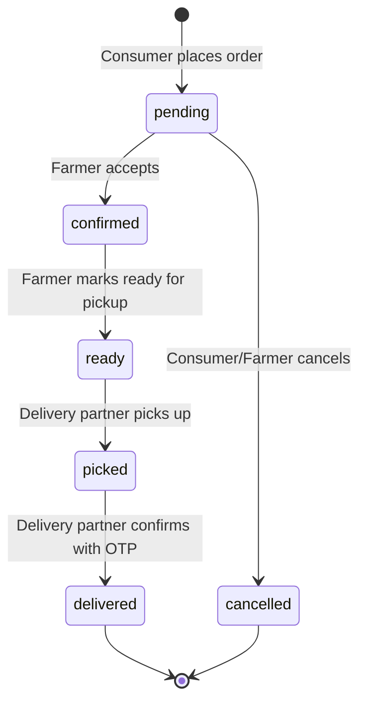

# Farm2Fork — Technical Architecture & Stack

## Tech Stack Overview

| Layer | Technology | Version | Purpose |
|-------|-----------|---------|---------|
| **Mobile** | React Native | 0.74.6 | Android native apps |
| **Navigation** | React Navigation | 6.x | Screen routing, tab bars, stack navigation |
| **State** | Zustand | 4.x | Lightweight global state (auth, listings, orders) |
| **HTTP** | Axios | 1.x | REST API calls with JWT interceptors |
| **Storage** | AsyncStorage | 1.x | Persisting auth tokens on device |
| **Backend** | Express.js | 4.x | REST API server |
| **Database** | PostgreSQL | 16 | Primary data store (users, orders, listings) |
| **Cache/Queue** | Redis | 7 | Session cache, Bull job queues |
| **ORM** | Sequelize | 6.x | Database models, migrations, queries |
| **Auth** | JWT + bcrypt | — | Token-based auth with hashed OTP |
| **SMS** | Twilio | 5.x | OTP delivery via SMS |
| **Payments** | Stripe | — | Payment intents, farmer payouts |
| **Real-time** | Socket.io | 4.x | Live order status, delivery tracking |
| **Containers** | Docker Compose | — | PostgreSQL + Redis infrastructure |

---

## Monorepo Structure

```
Farm2Fork/
├── apps/
│   ├── consumer-app/          🛒 Shopper-facing app
│   │   ├── android/           Android native project (Gradle)
│   │   ├── src/
│   │   │   ├── screens/       5 screens (Login, Browse, Detail, Orders, Profile)
│   │   │   ├── stores/        Zustand stores (auth, listings, orders)
│   │   │   └── api.js         Axios client + all API endpoints
│   │   ├── App.jsx            Root component (navigation + auth guard)
│   │   └── index.js           Entry point
│   │
│   ├── farmer-app/            👨‍🌾 Farmer-facing app
│   │   └── src/
│   │       ├── screens/       4 screens (Login, Dashboard, CreateListing, Orders)
│   │       ├── stores/
│   │       └── api.js
│   │
│   └── delivery-app/          🛵 Delivery partner app
│       └── src/
│           ├── screens/       2 screens (Login, Home with assignment management)
│           ├── stores/
│           └── api.js
│
├── backend/                   🖥️ Express.js API server
│   ├── src/
│   │   ├── controllers/       Business logic (auth, listings, orders, delivery, admin)
│   │   ├── models/            10 Sequelize models
│   │   ├── routes/            7 route modules (36 endpoints)
│   │   ├── middlewares/       Auth guard, validation, error handling, rate limiting
│   │   ├── services/          Stripe, notifications, delivery matching
│   │   ├── jobs/              Bull background jobs (basket expiry)
│   │   ├── config/            Socket.io, Firebase, DB config
│   │   └── app.js             Server entry point
│   ├── migrations/            12 Sequelize migrations
│   └── .env                   Environment config
│
├── docker-compose.yml         PostgreSQL 16 + Redis 7
└── package.json               Workspace root
```

---

## Architecture Diagram



---

## Database Schema (10 Tables)



---

## Authentication Flow



> [!NOTE]
> **Dev Mode:** OTP `123456` always works. Real Twilio SMS only fires when `NODE_ENV=production`.

---

## Order Lifecycle



| Step | Who | What Happens |
|------|-----|-------------|
| **Browse** | Consumer | Searches listings by category, pincode, organic filter |
| **Order** | Consumer | Selects quantity, creates order (Stripe payment intent) |
| **Accept** | Farmer | Sees new order on dashboard, taps "Accept" |
| **Ready** | Farmer | Packs the produce, marks "Ready for Pickup" |
| **Assign** | System | Matches nearest available delivery partner |
| **Pickup** | Delivery | Navigates to farm, picks up order |
| **Deliver** | Delivery | Navigates to consumer, confirms with delivery OTP |
| **Complete** | System | Releases payment to farmer, marks order delivered |

---

## API Endpoints (36 total)

| Module | Method | Endpoint | Auth |
|--------|--------|----------|------|
| **Auth** | POST | `/auth/otp/send` | No |
| | POST | `/auth/otp/verify` | No |
| | POST | `/auth/register` | No |
| | POST | `/auth/logout` | Yes |
| **Listings** | GET | `/listings` | No |
| | GET | `/listings/categories` | No |
| | GET | `/listings/:id` | No |
| | POST | `/listings` | Farmer |
| | PUT | `/listings/:id` | Farmer |
| | DELETE | `/listings/:id` | Farmer |
| | GET | `/listings/farmer/mine` | Farmer |
| **Orders** | POST | `/orders` | Consumer |
| | GET | `/orders/:id` | Yes |
| | GET | `/orders/consumer/mine` | Consumer |
| | GET | `/orders/farmer/mine` | Farmer |
| | PUT | `/orders/:id/accept` | Farmer |
| | PUT | `/orders/:id/ready` | Farmer |
| | PUT | `/orders/:id/cancel` | Yes |
| **Delivery** | PUT | `/delivery/availability` | Delivery |
| | GET | `/delivery/assignments` | Delivery |
| | PUT | `/delivery/assignments/:id/accept` | Delivery |
| | PUT | `/delivery/assignments/:id/pickup` | Delivery |
| | PUT | `/delivery/assignments/:id/deliver` | Delivery |
| | PUT | `/delivery/location` | Delivery |
| **Baskets** | GET | `/baskets` | No |
| | GET | `/baskets/:id` | No |
| | POST | `/baskets` | Yes |
| | POST | `/baskets/:id/join` | Yes |
| | PUT | `/baskets/:id/settle` | Yes |
| **Stripe** | POST | `/stripe/payment-intent` | Consumer |
| | POST | `/stripe/farmer/onboard` | Farmer |
| | POST | `/stripe/farmer/payout` | Farmer |
| | POST | `/stripe/webhook` | No |
| **Admin** | GET | `/admin/dashboard` | Admin |
| | GET | `/admin/users` | Admin |
| | PUT | `/admin/users/:id` | Admin |

---

## How the Pieces Connect at Runtime

```
┌─────────────────────────────────────────────┐
│  Your PC                                     │
│                                              │
│  Terminal 1: node src/app.js     (:3000)     │
│  Terminal 2: npx react-native    (:8081)     │
│       ↑ ADB reverse tcp:3000                 │
│       ↑ ADB reverse tcp:8081 (auto)          │
│       │                                      │
│  ┌────┴──────────┐  ┌───────────────────┐    │
│  │ PostgreSQL:5432│  │ Redis:6379        │    │
│  │ (Docker)      │  │ (Docker)          │    │
│  └───────────────┘  └───────────────────┘    │
└──────────────┬──────────────────────────────┘
               │ USB Cable
         ┌─────┴─────┐
         │ 📱 Phone   │
         │ Consumer   │
         │ App        │
         └───────────┘
```
